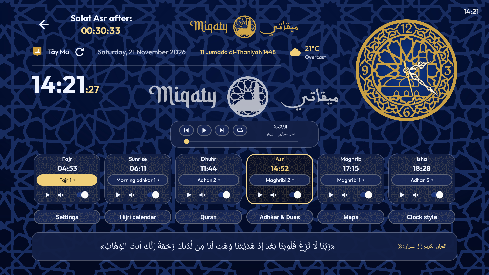
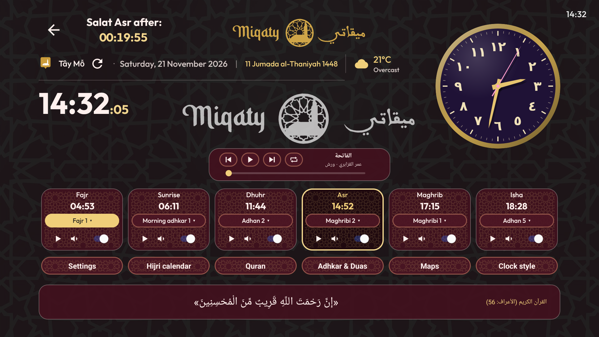
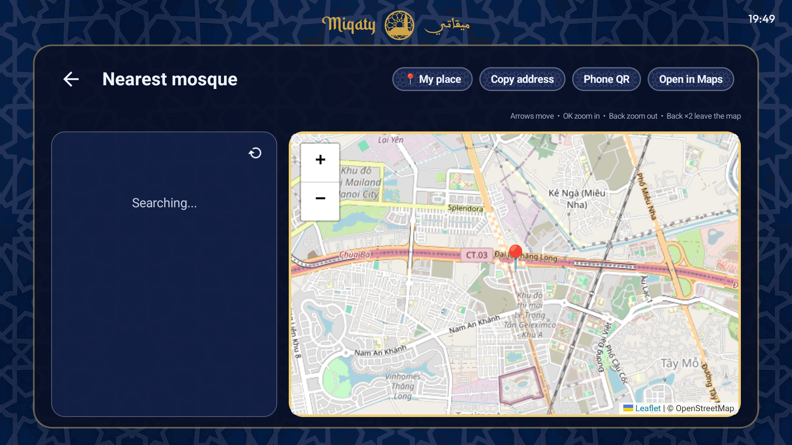
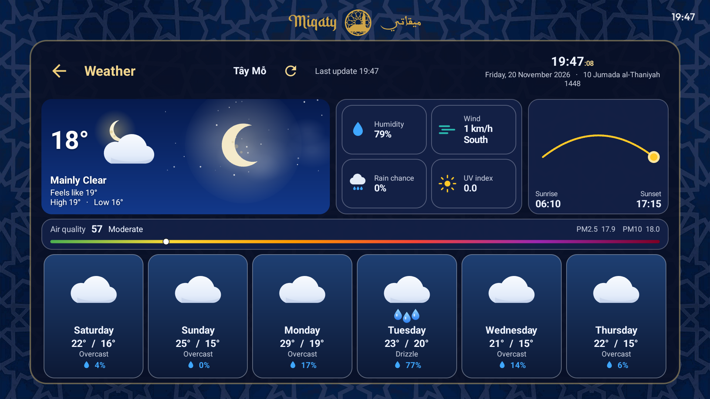
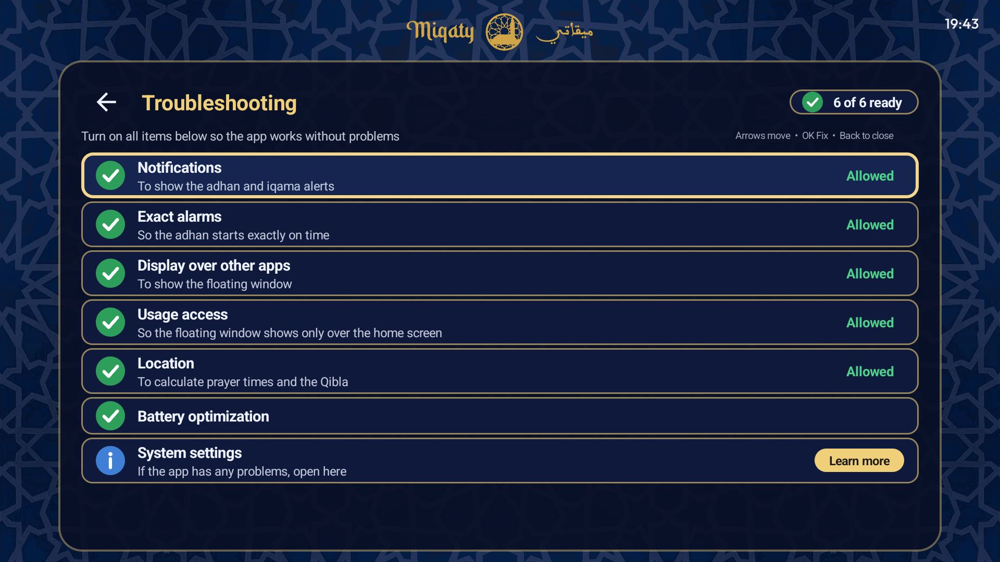
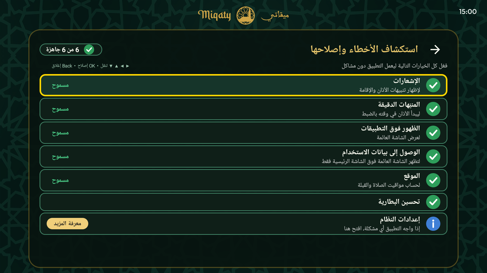

# ميقاتي (Miqaty) — مواقيت الصلاة والأذان لأجهزة Android TV

**ميقاتي (Miqaty)** هو تطبيق إسلامي مجاني بالكامل ومصمم خصيصاً لأجهزة **Android TV** و **Google TV**. يوفر التطبيق مواقيت الصلاة الدقيقة بدون إنترنت، الأذان التلقائي في الخلفية، القرآن الكريم، الأذكار، اتجاه القبلة، وخريطة المساجد والمطاعم الحلال القريبة — مع تحكم كامل بواسطة جهاز التحكم عن بعد (الريموت) و**بدون أي إعلانات أو تتبع أو اشتراكات**.

> 🌐 [Read in English](README.md)

## 📸 صور من التطبيق

  
  

  
  

  
  

  

---

## 📥 طريقة التثبيت السريعة على التلفاز (Android TV / Google TV)

### الطريقة الأولى: عبر تطبيق Downloader (الأسهل)
1. ثبّت تطبيق **Downloader by AFTVnews** من متجر Google Play على تلفازك.
2. فعّل خيار تثبيت التطبيقات من مصادر غير معروفة: اذهب إلى **الإعدادات (Settings) ← التطبيقات (Apps) ← الأمان والقيود (Security & Restrictions) ← تثبيت تطبيقات غير معروفة ← Downloader** وقم بتفعيله.
3. افتح تطبيق **Downloader**، وأدخل الرمز المختصر **`2676598`** ثم اضغط على **Go**.
4. اتبع التعليمات التي تظهر على الشاشة لإكمال تثبيت تطبيق **ميقاتي**.

### الطريقة الثانية: التحميل المباشر لملف APK
يمكنك تحميل ملف `Miqaty-1.0.0.apk` مباشرة من صفحة [الإصدارات (Releases)](https://github.com/ynselmahdi-cyber/Miqaty-TV-APK/releases) وتثبيته عبر ذاكرة USB أو أداة ADB.

---

## ✨ المميزات الرئيسية

### 🕌 مواقيت صلاة دقيقة تعمل بدون إنترنت
* **12 طريقة حساب معتمدة:** رابطة العالم الإسلامي (الافتراضية)، أم القرى، الهيئة المصرية العامة للمساحة، كراتشي، أمريكا الشمالية (ISNA)، تركيا (ديانت)، الكويت، قطر، دبي، سنغافورة، طهران، بالإضافة إلى إمكانية تخصيص زوايا الفجر والعشاء (10°–22°).
* **المذهب الفقهي والتعديل اليدوي:** يدعم حساب العصر حسب مذهب الجمهور (الشافعي/المالكي/الحنبلي) والحنفي، مع إمكانية تعديل الدقائق يدوياً لكل صلاة، ودعم نظام 12 و24 ساعة.
* **قاعدة بيانات مدن مدمجة:** يعمل التطبيق بدون إنترنت عبر قاعدة بيانات مدن مدمجة، مع خيار تحديد الموقع تلقائياً عبر GPS أو الشبكة.
* **التقويم الهجري والميلادي:** عدّاد تنازلي مباشر للصلاة القادمة مع عرض التاريخ الهجري والمناسبات الإسلامية.

### 🔊 نظام الأذان والإقامة وأذكار الصباح
* **أصوات أذان متنوعة:** يضم 7 أصوات أذان عامة، و4 أصوات مخصصة لأذان الفجر، وصوتين للأذان المغربي، مع إمكانية تفعيل أو إيقاف الأذان والتحكم في مستوى الصوت لكل صلاة على حدة.
* **إيقاظ الشاشة وعرض الدعاء:** يقوم التطبيق بإيقاظ شاشة التلفاز تلقائياً عند دخول وقت الصلاة وعرض دعاء ما بعد الأذان بشكل متزامن.
* **التنبيهات وساعات الهدوء:** منبه قبل الأذان (من 5 إلى 20 دقيقة)، ومنبه الإقامة (6 أصوات مختلفة)، وتشغيل تلقائي لأذكار الصباح عند الشروق، وتنبيه رأس الساعة، مع وضع ساعات الهدوء الليلية (22:00–07:00).

### 📖 القرآن الكريم، الأذكار، القبلة والخرائط
* **مشغل القرآن الكريم:** عرض نص القرآن الكريم بالرسم العثماني مع الاستماع لأكثر من 50 قارئاً عبر البث المباشر، بالإضافة إلى تكبيرات العيد.
* **الأذكار اليومية:** أذكار الصباح والمساء مدمجة وتعمل صوتياً بدون إنترنت.
* **اتجاه القبلة:** حساب دقيق لاتجاه القبلة والمسافة إلى الكعبة المشرفة بدون الحاجة للإنترنت.
* **خريطة المساجد والأكل الحلال:** خريطة تفاعلية لاكتشاف المساجد والمطاعم الحلال القريبة، بالإضافة إلى توقعات الطقس وجودة الهواء.

### 🎨 تخصيص الواجهة والويدجت العائم
* **12 مظهراً (Themes):** تشمل الليل الذهبي، الزمردي، الأزرق الملكي، الرملي الفاتح، الأسود الخالص، الأزرق الشفشاوني، وغيرها.
* **15 تصميماً للساعة:** تشكيلة متنوعة من الساعات الرقمية والتناظرية المصممة لشاشات التلفاز الكبيرة.
* **ويدجت عائم (Floating Widget):** نافذة مصغرة اختيارية تعرض الساعة والعد التنازلي للصلاة القادمة فوق الشاشة الرئيسية أو شاشة التوقف.
* **واجهة ثنائية اللغة:** دعم كامل للغتين **العربية** و**الإنجليزية**.

---

## 🔒 الخصوصية والمواصفات التقنية

* **مجاني وآمن 100%:** لا يحتوي التطبيق على أي إعلانات، ولا أدوات تتبع أو تحليلات، ولا يتطلب إنشاء حساب؛ ولا يتم جمع أو مشاركة أي بيانات.
* **التوافق:** يعمل على أنظمة Android 8.0 فما فوق (API 26 إلى API 34)، ومصمم للتنقل السلس عبر أزرار الريموت (D-Pad).
* **معرّف الحزمة (Package ID):** `com.ynselmahdi.miqaty.tv`
* **الإصدار الحالي:** `v1.0.0`

