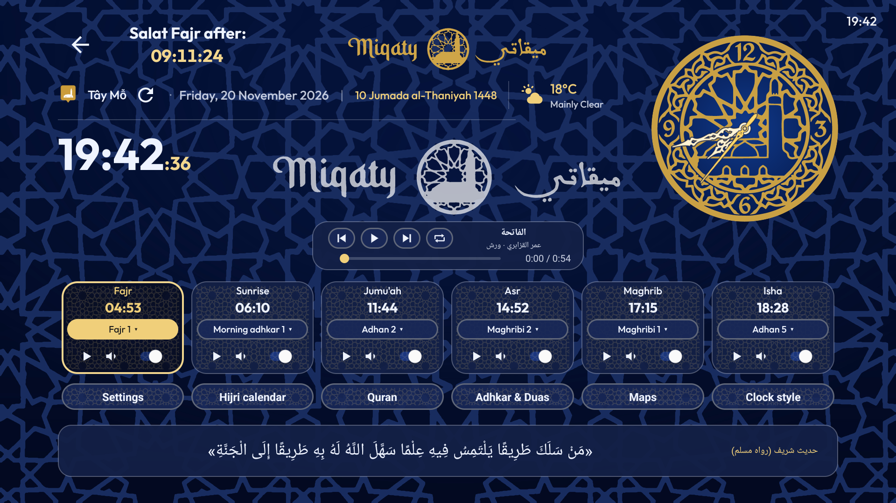
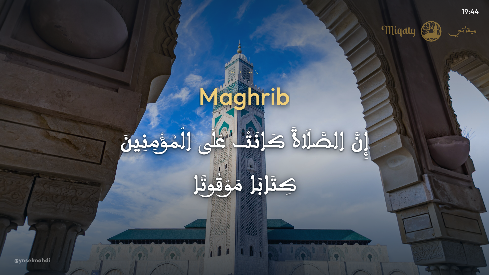
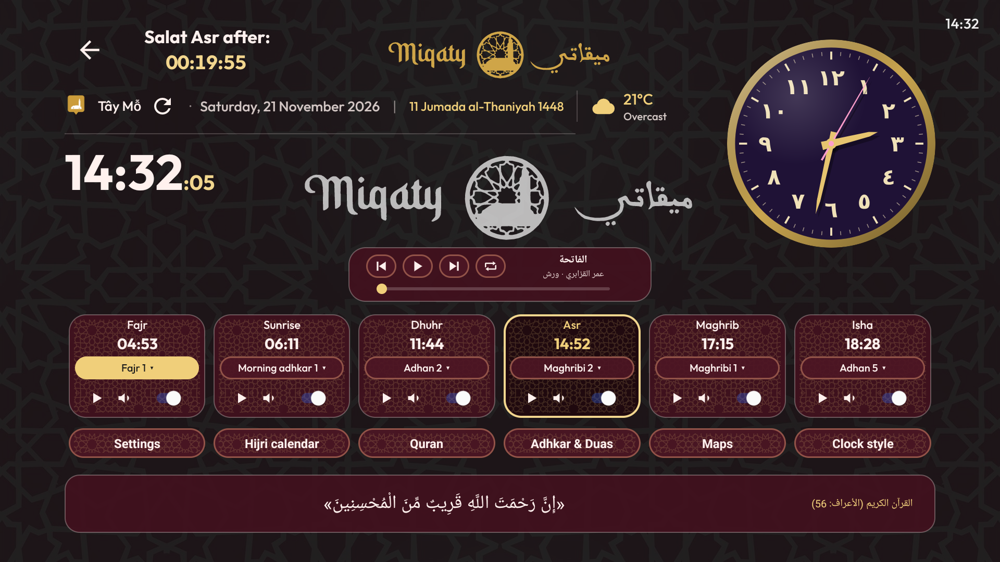
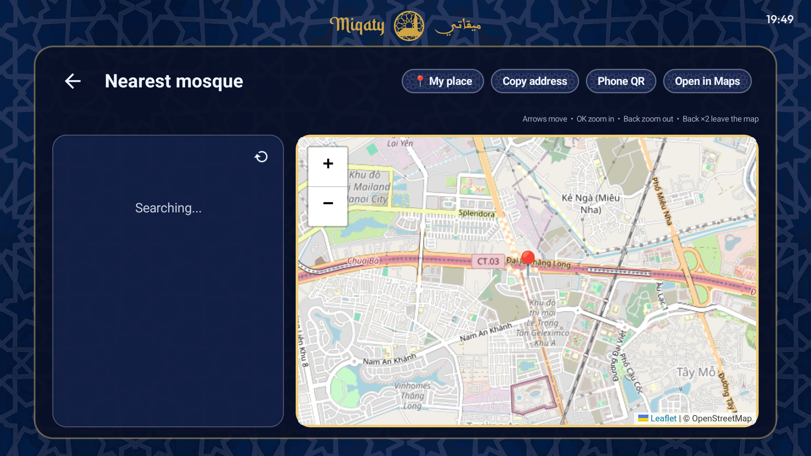
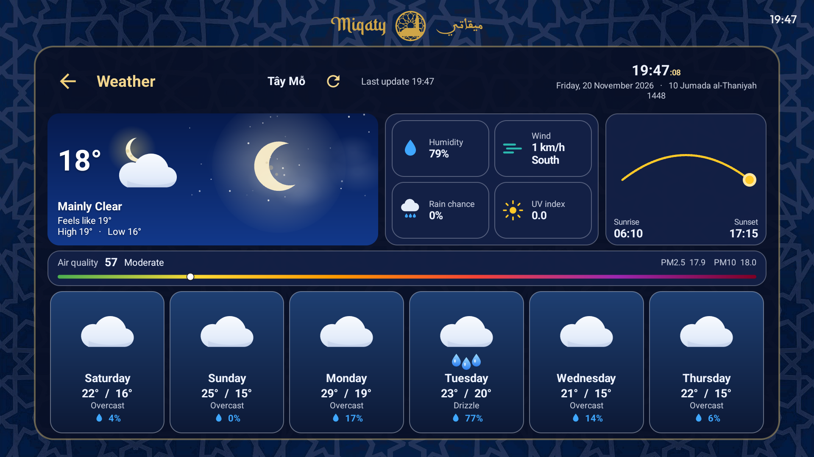
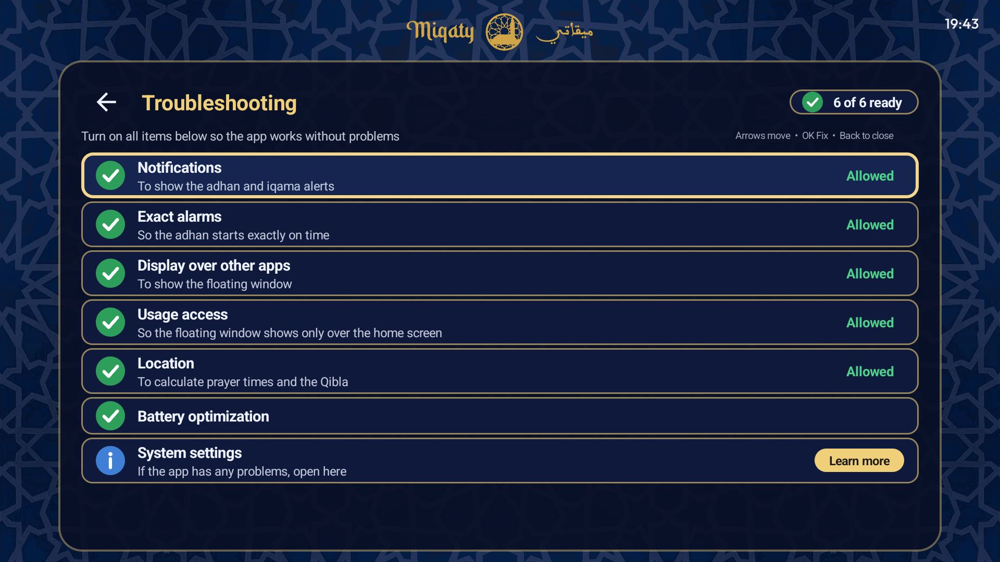

# Miqaty (ميقاتي) — Islamic Prayer Times & Adhan for Android TV

> 🌐 [النسخة العربية](README.ar.md)

**Miqaty** is a free, privacy-first Islamic companion application built specifically for **Android TV** and **Google TV** devices. It delivers accurate offline prayer times, automatic Adhan alerts, Quran streaming, Adhkar, Qibla direction, and local Mosque/Halal food discovery—all controllable via your TV remote (D-Pad) with **zero ads, zero tracking, and no account required**.

## 📸 Screenshots

  
  

  
  

  
  

---

## 📥 Quick Installation (Android TV / Google TV)

### Method 1: Using the Downloader App (Recommended)
1. Install **Downloader by AFTVnews** from the Google Play Store on your Android TV.
2. Enable unknown sources: go to **Settings → Apps → Security & Restrictions (or Special App Access) → Install unknown apps → Downloader** and turn it **ON**.
3. Open **Downloader**, enter the short code **`2676598`**, and press **Go**.
4. Follow the on-screen prompt to install **Miqaty**.

### Method 2: Direct APK Download
Download `Miqaty-1.0.0.apk` directly from the [Releases](https://github.com/ynselmahdi-cyber/Miqaty-TV-APK/releases) page and sideload it via USB or ADB (`adb install -r Miqaty-1.0.0.apk`).

---

## ✨ Key Features

### 🕌 Accurate Prayer Times & Offline Engine
- **12 Calculation Methods:** Muslim World League (default), Umm al-Qura, Egyptian General Authority, Karachi, ISNA (North America), Turkey (Diyanet), Kuwait, Qatar, Dubai, Singapore, Tehran, plus custom Fajr/Isha angles (10°–22°).
- **Madhab & Fine-Tuning:** Supports Shafi/Maliki/Hanbali and Hanafi Asr calculations, per-prayer manual minute offsets, and 12h/24h time formats.
- **Offline City Database:** Includes a built-in offline city database (`cities.bin`) alongside optional GPS/network and IP-based location detection.
- **Hijri & Gregorian Calendar:** Displays live countdowns to the next prayer, Hijri dates, and Islamic occasions.

### 🔊 Adhan, Iqama & Morning Adhkar
- **Customizable Adhan Audio:** Includes 7 general Adhan tracks, 4 dedicated Fajr Adhan tracks, and 2 Maghribi Adhan tracks, with independent per-prayer enable toggles and volume controls.
- **Screen Wake & Dua Display:** Automatically wakes the TV screen at prayer time (`showWhenLocked` / `turnScreenOn`) and displays synchronized post-Adhan Dua.
- **Reminders & Quiet Hours:** Configurable pre-Adhan reminders (5–20 min), Iqama countdown alarms (6 sound options), automatic Sunrise Morning Adhkar, hourly chimes, and Quiet Hours (22:00–07:00).

### 📖 Quran, Adhkar, Qibla & Local Discovery
- **Quran Player:** Uthmani Quran text with audio streaming from over 50 reciters via `mp3quran.net`, plus Eid Takbirat recordings.
- **Daily Adhkar:** Built-in morning and evening Adhkar with offline audio playback.
- **Qibla Compass:** Offline great-circle bearing and distance calculation to the Kaaba.
- **Mosques & Halal Food Map:** Interactive OpenStreetMap-powered hub to locate nearby mosques and halal restaurants, plus local weather and air quality forecasts.

### 🎨 Android TV Customization & Floating Widget
- **12 Visual Themes:** Golden Night, Emerald, Royal Blue, Light Sand, Night Purple, Pure Black, Royal Burgundy, Chefchaouen Blue, Slate Gray, Mint Green, Night Mode, and Light Mode.
- **15 Clock Faces:** Multiple analog and digital clock styles designed for large TV screens.
- **Floating & PiP Widget:** Optional overlay widget that displays the clock and next prayer countdown over the TV home screen or system screensaver.
- **Bilingual Interface:** Full support for **English** and **Arabic** (with complete RTL layout support).

---

## 🔒 Privacy & Technical Specifications

- **100% Free & Private:** No advertisements, no analytics, no crash trackers, no Firebase, and no user accounts. Nothing is collected, sold, or shared.
- **Compatibility:** Android 8.0+ (API 26 to API 34), optimized for Android TV, Google TV, and D-Pad remote navigation.
- **Package ID:** `com.ynselmahdi.miqaty.tv`
- **Current Release:** `v1.0.0`
